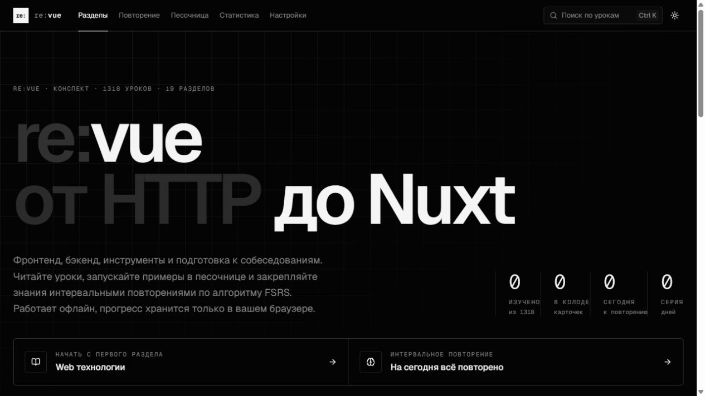
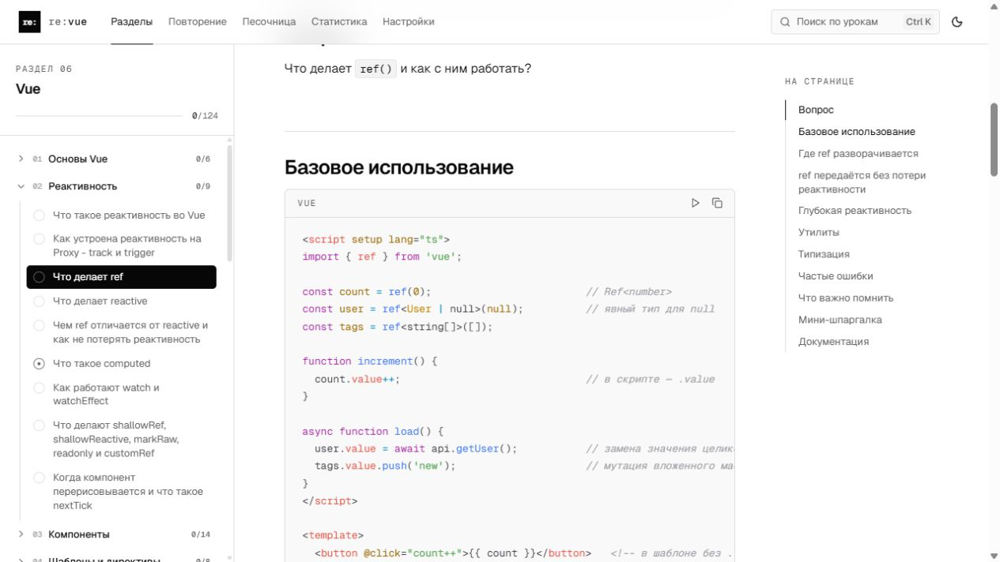
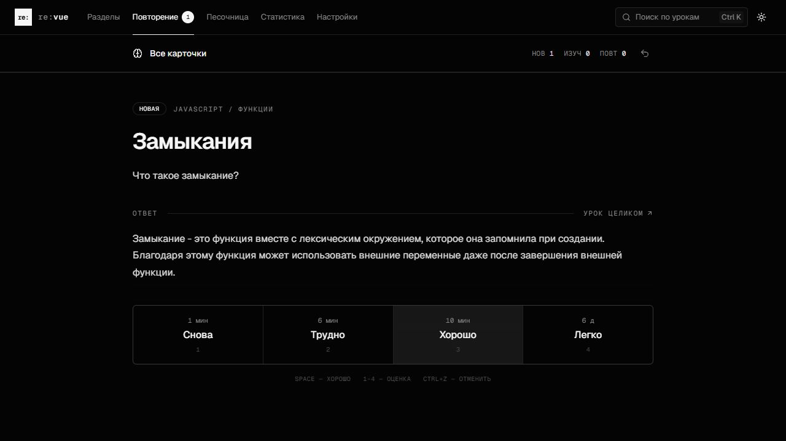
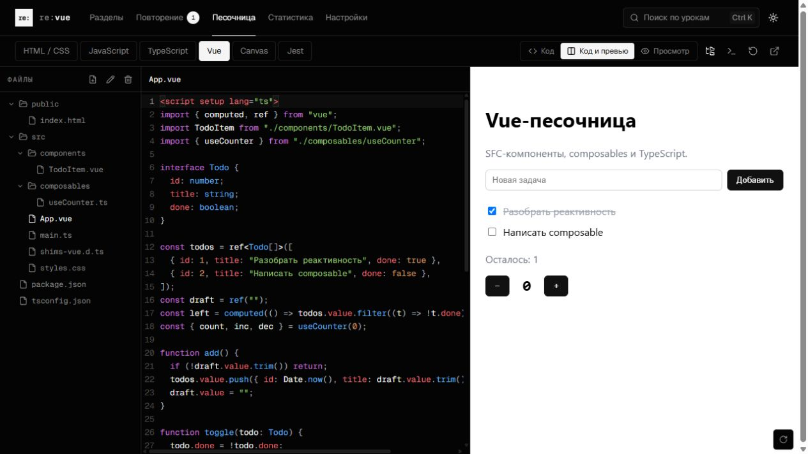

# re:vue

Конспект по разработке и сайт для его изучения: **фронтенд, бэкенд, инструменты и подготовка к собеседованиям** — с живыми примерами, песочницей и интервальным повторением.

**[Открыть сайт →](https://marat-vue.github.io/revue/)** · [Запустить локально](#запуск-локально)

[](https://github.com/marat-vue/revue/actions/workflows/deploy.yml)

[](https://marat-vue.github.io/revue/)

- **Более 1300 уроков** в Markdown — от HTTP и вёрстки до JavaScript, TypeScript, Vue, Nuxt, Express, SQL, Docker, System Design и поведенческого интервью.
- **Каждый урок — карточка для повторения**: вопрос с собеседования, короткий ответ и подробный разбор с примерами кода.
- **Сайт-тренажёр** в папке [`site/`](site/) — чтение уроков, живые примеры и песочница, отметки прогресса, поиск и повторение по алгоритму FSRS. Устанавливается как приложение и работает офлайн.

> [!TIP]
> Уроки — обычные Markdown-файлы, поэтому их удобно читать прямо на GitHub или открыть папку как хранилище [Obsidian](https://obsidian.md/): каллауты `> [!NOTE]` и ссылки между заметками там отображаются так же, как на сайте.

## Скриншоты

| Чтение уроков | Интервальное повторение |
| --- | --- |
|  |  |
| Навигация по разделам, примеры кода и светлая тема. | Вопрос, краткий ответ и четыре оценки запоминания. |

**Песочница: редактор, файлы и живое превью Vue**



## Содержание

| № | Раздел | Уроков | О чём |
| --- | --- | ---: | --- |
| 01 | [Web технологии](<01. Web технологии/>) | 49 | HTTP, заголовки и cookies, REST, CORS и кэширование, авторизация и web security, работа браузера |
| 02 | [HTML](<02. HTML/>) | 62 | Семантика, формы, медиа, метаданные, доступность |
| 03 | [CSS](<03. CSS/>) | 76 | Специфичность, Box Model, Flexbox и Grid, адаптивность, анимации, современные возможности |
| 04 | [JavaScript](<04. JavaScript/>) | 196 | Типы, замыкания, прототипы, асинхронность и Event Loop, DOM, классы, паттерны проектирования |
| 05 | [TypeScript](<05. TypeScript/>) | 69 | Типы и интерфейсы, дженерики, utility и продвинутые типы, narrowing, антипаттерны |
| 06 | [Vue](<06. Vue/>) | 124 | Реактивность и компоненты, слоты и формы, Composition API, Pinia, Vue Router 5, производительность и тесты, Vite, VueUse, Vuetify, Tailwind, Motion |
| 07 | [Node.js](<07. Node/>) | 88 | Модули, Event Loop, файловая система, HTTP, Streams, процессы, производительность и безопасность |
| 08 | [Express](<08. Express/>) | 56 | Маршрутизация, middleware, API, авторизация, базы данных, тестирование и production |
| 09 | [Nuxt](<09. Nuxt/>) | 69 | Структура проекта и роутинг, SSR и гидрация, загрузка данных, Nitro, SEO и модули |
| 10 | [SQL](<10. SQL/>) | 101 | Запросы и JOIN, агрегация и оконные функции, CTE, схема и нормализация, транзакции и блокировки, индексы и EXPLAIN, PostgreSQL, практика backend |
| 11 | [Тестирование](<11. Тестирование/>) | 100 | QA с нуля до Junior+: теория и принципы, тест-дизайн, чек-листы и кейсы, баг-репорты и документация, web/API, Postman, Playwright, учебный стенд и интервью; Vitest, моки, Vue Test Utils и Vue Testing Library, Pinia и TanStack Vue Query |
| 12 | [Сборка и инструменты](<12. Сборка и инструменты/>) | 24 | Vite и webpack для Vue, компиляция SFC и vue-tsc, ESLint для Vue, монорепозитории, оптимизация бандла |
| 13 | [Docker](<13. Docker/>) | 50 | Контейнеры и образы, Dockerfile, сети и хранилища, Compose, упаковка Vue SPA и Nuxt-приложений |
| 14 | [Алгоритмы и структуры данных](<14. Алгоритмы и структуры данных/>) | 63 | Сложность, линейные структуры, сортировки, деревья и графы, DP, паттерны решения задач |
| 15 | [SEO](<15. SEO/>) | 70 | Обход и индексация, контент и метаданные, structured data, Core Web Vitals, аналитика и продвижение |
| 16 | [Frontend System Design](<16. Frontend System Design/>) | 23 | Архитектура и данные, нефункциональные требования, разбор типовых задач |
| 17 | [Задачи с лайвкодинга](<17. Задачи с лайвкодинга/>) | 52 | Замыкания, промисы, «что выведет консоль», утилиты, задачи на Vue и TypeScript |
| 18 | [Поведенческое интервью](<18. Поведенческое интервью/>) | 19 | Рассказ о себе, сложные задачи, конфликты, вопросы работодателю |
| 19 | [Agile](<19. Agile/>) | 26 | Ценности и принципы, Scrum, требования и backlog, оценка и планирование, Kanban, практика frontend-команды |

Справочные материалы:

- [Git](<20. Git.md>) — команды и сценарии, о которых спрашивают на собеседованиях.

Ссылки на документацию и дополнительные источники находятся в самих уроках.

## Как устроен урок

Структура папок: **раздел → тема → урок**, например `04. JavaScript/01. Основы языка/03. ….md`. В разделах с картой (`00. Карта раздела …`) есть рекомендуемый порядок изучения.

Каждый урок построен одинаково:

```markdown
# Заголовок урока

> [!NOTE]
> Короткий ответ — то, что стоит сказать на собеседовании в первые 30 секунд.

## Вопрос

Формулировка вопроса, как его задают на интервью.

## Основная идея

Подробный разбор, примеры кода, подводные камни и уточняющие вопросы.
```

На сайте секция «Вопрос» становится лицевой стороной карточки, а каллаут `[!NOTE]` — ответом.

## Сайт для изучения и повторения

Статический сайт на **Nuxt 4** (статическая генерация) · Vue 3 · TypeScript · Pinia · Tailwind CSS 4 · reka-ui · Shiki · ts-fsrs · Sandpack и CodeMirror 6.

- **Чтение** — дерево разделов, оглавление урока, прогресс чтения, переходы между уроками, светлая и тёмная темы.
- **Интервальное повторение** — карточки планируются алгоритмом [FSRS](https://github.com/open-spaced-repetition/ts-fsrs): чем лучше помнишь ответ, тем реже он попадается.
- **Фильтры разделов** — по направлению (Frontend, Backend, GameDev…), языку и статусу прохождения.
- **Песочница** — HTML/CSS, JavaScript, TypeScript, Vue и canvas с файлами и папками, консолью и режимом просмотра, плюс тренировка тестов (Jest и Vue Testing Library); проекты сохраняются в браузере, код из урока открывается в ней одной кнопкой.
- **Живые примеры** — часть примеров в уроках запускается прямо на странице: код можно менять и сразу видеть результат или прогон тестов.
- **Поиск** — по всем урокам через `Ctrl K` или `/`.
- **Статистика** — изученные уроки, история повторений и прогноз нагрузки.
- **Приложение и офлайн** — сайт устанавливается как PWA; главная, повторение карточек и открытые уроки работают без сети, разделы целиком можно скачать в настройках.
- **Без бэкенда** — весь прогресс хранится в `localStorage`; в настройках есть экспорт и импорт в JSON для переноса между устройствами.

### Запуск локально

Нужен Node.js 22.12+ или 24+ (в CI используется Node.js 22).

```bash
cd site
npm install
npm run dev
```

Сайт откроется на <http://localhost:3000>. Для production-сборки выполни `npm run build` — статический сайт появится в `site/.output/public/`, посмотреть его можно командой `npm run preview`.

### Деплой

Пуш в `main` запускает [GitHub Actions](.github/workflows/deploy.yml), который собирает сайт и публикует его на GitHub Pages. Для первого запуска включи в настройках репозитория **Settings → Pages → Source: GitHub Actions**.

Подробности об устройстве сайта — в [`site/README.md`](site/README.md).

## Горячие клавиши на сайте

| Клавиша | Действие |
| --- | --- |
| `Ctrl K` или `/` | Поиск по урокам |
| `Space` | Показать ответ / оценить «Хорошо» |
| `1`–`4` | Оценка карточки: «Снова», «Трудно», «Хорошо», «Легко» |
| `Ctrl Z` | Отменить последнюю оценку |

## Как добавить или исправить урок

1. Создай Markdown-файл в нужной теме, сохранив нумерацию: `NN. Название урока.md`.
2. Следуй структуре урока: заголовок, каллаут `[!NOTE]` с коротким ответом, секция `## Вопрос`, затем разбор.
3. Проверь отображение через `npm run dev` в папке `site/`.

### Живые примеры в уроке

Блок кода с флагом `run` получает кнопку «Запустить пример»: прямо в уроке открывается редактор с превью (или с тестами), код можно менять.

````markdown
```html run=card            ← блоки с одним именем объединяются в один пример
<div class="card">…</div>
```

```css run=card
.card { display: grid; }
```

```ts run=sum file=sum.ts   ← file= кладёт блок в отдельный файл, чтобы работали импорты
export const sum = (a: number, b: number) => a + b;
```

```ts run=sum file=sum.test.ts
import { sum } from "./sum";
test("складывает", () => expect(sum(1, 2)).toBe(3));
```
````

Среда выбирается по языкам блоков: HTML/CSS — статическая страница, JS/TS — модули, `vue` — Vue, код с `describe`/`test` и `expect` — тесты (Jest-совместимый раннер, `vi` из Vitest работает как `jest`). Сторонние пакеты из `import` подключаются автоматически.

> [!IMPORTANT]
> Прогресс привязан к пути урока **без номеров**. Перенумерация файлов и папок прогресс не сбрасывает, а переименование — сбрасывает.

## Лицензия

[MIT](LICENSE)
